# Filter guide

A reference for every effect ("filter") a track can have. For each one:

- **What it is**, in plain words.
- **Settings**, with each setting's range and default and what turning it up or down does to the sound.
- **What happens to the wave**: reference pictures, under "Advanced".

This is the source text for in-app help later (PENDING: help pop-ups on effect boxes).

**The pictures are measured, not drawn.** Each one was made by running test sounds (a pure tone, white noise, a click, plucked notes) through the app's own effect code. To regenerate them after a sound-processing change:

```sh
cargo run --release -p voiceloop-dsp --example figures -- docs/projects/effects/figures
```

Ranges and defaults come from `crates/voiceloop-dsp/src/spec.rs` and `src/effects/types.ts`.

## Contents

- [Basics](#basics)
- [How to read the pictures](#how-to-read-the-pictures)
- Tone: [Gain](#gain) · [Filter](#filter) · [3-band EQ](#3-band-eq)
- Dynamics: [Gate](#gate) · [Compressor](#compressor)
- Space: [Delay](#delay) · [Reverb](#reverb)
- Character: [Saturation](#saturation) · [Bitcrusher](#bitcrusher)
- Movement: [Auto filter](#auto-filter) · [Chorus](#chorus) · [Flanger](#flanger) · [Phaser](#phaser) · [Tremolo](#tremolo) · [Ring mod](#ring-mod)
- [Glossary](#glossary)
- [Oscilloscope (planned)](#oscilloscope-planned)

## Basics

- **Chain order matters.** Effects run top to bottom, and each one hears the output of the one before it.
  - A compressor before a reverb evens out your voice, then adds space.
  - A reverb before a compressor squashes the room sound too, so the tail gets louder.
  - Typical order: Gate → EQ/Filter → Compressor → Saturation → Modulation → Delay → Reverb.
- **Wet/dry (mix)** blends the effect with the original. 0 is the original only (bit-exact) and 1 is the effect only.
  - Echo and space effects start partly wet: delay 0.35, reverb 0.3, chorus/flanger/phaser 0.5.
  - Every other effect starts fully wet (1).
- **Bypass** switches one effect off without losing its settings. The chain switch bypasses all of them.
- **Layers:** the chain processes **All layers** by default. **Choose layers** sends only some layers through the chain and plays the rest unchanged.
- **Tempo sync:** delay, auto filter and tremolo can lock their time to the song tempo, for example 1/8 = one eighth note. When sync is on, the plain time or rate setting is ignored.
- **Changing settings while playing:**
  - Number settings glide, so they never click.
  - Changing a choice (such as filter type or saturation mode) and adding, removing or reordering effects crossfade over about 10 ms. That cuts off a ringing reverb or delay tail.
- **Mono for now.** All effects are mono, including reverb and the movement effects. Stereo width comes later (PENDING).

## How to read the pictures

| Picture | How to read it |
| --- | --- |
| **Waveform** (Amplitude over time) | The gray line is the sound going in and the colored lines are what comes out. Taller means louder. |
| **Level** (dB over time) | Loudness on a log scale. Every −6 dB halves the level; −60 dB is nearly silent. |
| **Response** (dB over Frequency) | How much each pitch region is boosted (above 0) or cut (below 0). Left is low/bass, right is high/treble. 1k = 1000 Hz, around the top of a singing voice's fundamental. |
| **Spectrum** | Which frequencies are present in a sound. A pure tone is one spike, and new spikes are new overtones. |
| **Spectrogram** (heat map) | Frequency (up) over time (right). Brighter means louder, so dark bands are frequencies being removed. Moving dark bands are the "swoosh" of flangers and phasers. |
| **Curve** (output against input) | How each sample value is reshaped. A straight diagonal means unchanged, and bending means distortion. |

---

## Gain

**What it is:** a volume knob. It makes the sound louder or quieter without changing its character. Use it to balance a track before other effects, or to make up level after an EQ cut.

| Setting | Range (default) | What it does |
| --- | --- | --- |
| Gain | −36 to +24 dB (0) | Volume. +6 dB is about twice the amplitude and −6 dB about half. Too much boost clips (distorts) at the output. |

<details><summary>Advanced: what happens to the wave</summary>

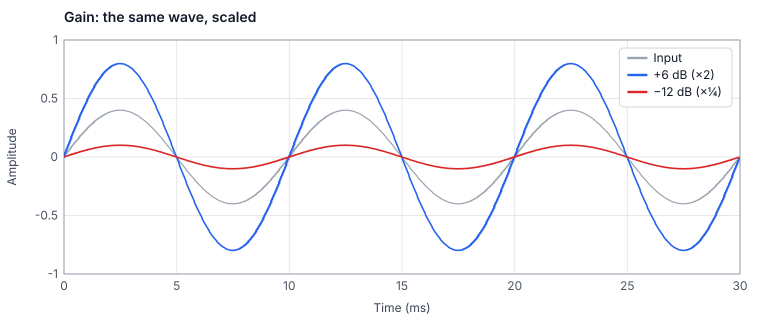

The wave keeps its exact shape and is only scaled taller or shorter.
</details>

## Filter

**What it is:** removes or emphasizes part of the frequency range. It's the most useful single tone tool:

- Cut rumble with a highpass.
- Make a voice sound muffled or "behind a wall" with a lowpass.
- Make a thin "telephone" sound with a bandpass.
- Remove one annoying ring with a notch.

| Setting | Range (default) | What it does |
| --- | --- | --- |
| Type | lowpass, highpass, bandpass, notch, lowshelf, highshelf, peak (lowpass) | **lowpass** keeps lows and darkens. **highpass** keeps highs and thins out bass and rumble. **bandpass** keeps a band around the cutoff (telephone, radio). **notch** removes a narrow band (hum, a ringing note). **lowshelf/highshelf** boost or cut everything below or above the cutoff, like a bass/treble knob. **peak** boosts or cuts a band around the cutoff. |
| Cutoff | 20 to 20,000 Hz (1,200) | Where the filter acts. On a lowpass, lower means darker and more muffled. On a highpass, higher means thinner. |
| Q (resonance) | 0.1 to 18 (0.707) | How sharp the corner is. 0.707 is smooth and natural. Higher Q adds a resonant peak at the cutoff ("wah", "whistle", synth squelch); very high Q rings. On bandpass, notch and peak, higher Q means a narrower band. |
| Gain | −24 to +24 dB (0) | Shelf and peak types only: how much to boost (+) or cut (−). |

**Tips:**
- A highpass at 80–120 Hz cleans up almost any vocal loop.
- A lowpass sweeping from 300 Hz up to 8 kHz is a classic build-up.

<details><summary>Advanced: what happens to the wave</summary>

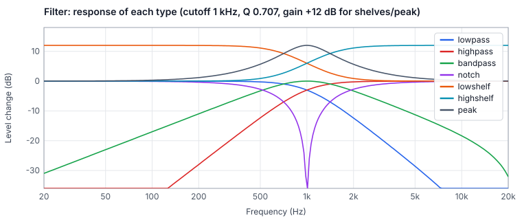

Each type's response at 1 kHz. Lowpass and highpass roll off 12 dB per octave beyond the cutoff. Shelves and peak use +12 dB here.

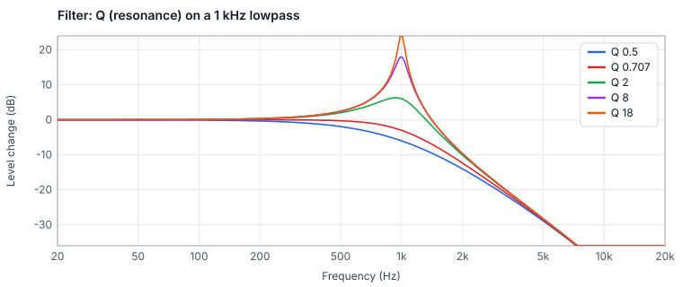

Raising Q makes a bump right at the cutoff. Q 18 boosts that frequency by about 25 dB, which you hear as resonance.

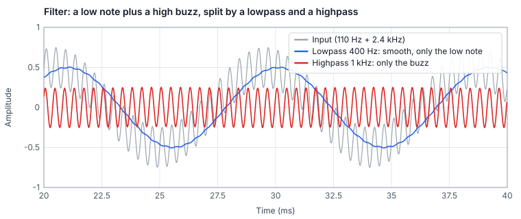

A low note with a high buzz on top. The lowpass leaves the smooth low wave, and the highpass leaves only the fast buzz.
</details>

## 3-band EQ

**What it is:** three tone controls in one box:

- a **low shelf** (bass);
- a **mid peak** you can move (body, nasal, presence);
- a **high shelf** (air, brightness).

Use it to shape a voice gently. Cuts usually sound more natural than boosts.

| Setting | Range (default) | What it does |
| --- | --- | --- |
| Low | −24 to +24 dB (0) | Bass. Boost for warmth and weight; cut to remove boominess or mud. |
| Low freq | 40 to 800 Hz (200) | Where "bass" ends. Higher includes more of the voice's body. |
| Mid | −24 to +24 dB (0) | Boost or cut a band. Around 300–500 Hz is boxy or muddy, 800 Hz–1.5 kHz nasal or honky, 2–5 kHz presence or harshness. |
| Mid freq | 200 to 8,000 Hz (1,000) | The center of the mid band. |
| Mid Q | 0.2 to 8 (0.9) | Width of the mid band. Low is broad and musical; high is a surgical fix for one problem frequency. |
| High | −24 to +24 dB (0) | Treble or "air". Boost for sparkle; cut to soften harsh "s" sounds or hiss. |
| High freq | 1,000 to 16,000 Hz (4,000) | Where "treble" starts. |

**Tip:** to find a bad frequency, boost Mid a lot with a high Q, sweep Mid freq until it sounds worst, then cut there.

<details><summary>Advanced: what happens to the wave</summary>

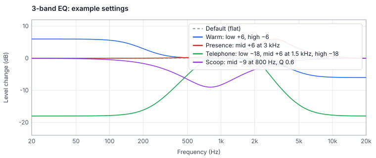

Four example settings. "Telephone" removes lows and highs and pushes the middle; "Scoop" dips the mids for a hollow, modern sound.
</details>

## Gate

**What it is:** a door that closes when the sound gets quiet. Between phrases it turns down room hiss, breaths and headphone bleed, and it opens again when you sing.

It's for steady noise when nobody's singing. For hiss under the singing too, use noise reduction (Learn room) instead.

| Setting | Range (default) | What it does |
| --- | --- | --- |
| Threshold | −90 to 0 dB (−50) | How loud a sound must be to open the gate. Set it just above the noise and below your quietest singing. Too high chops off soft notes and word endings. |
| Range | −90 to 0 dB (−60) | How much the closed gate turns the sound down. −90 is near-silent; −10 to −20 just tucks noise down and sounds more natural. |
| Attack | 0.1 to 50 ms (1) | How fast it opens. Fast keeps consonants crisp; slower softens the start of each note (and can lose it). |
| Hold | 0 to 500 ms (30) | How long it stays open after the sound drops. It stops the gate chattering on and off during short dips. |
| Release | 5 to 2,000 ms (120) | How fast it closes after the hold. Fast is abrupt (a "chopped" effect); slow lets notes ring out naturally. |

<details><summary>Advanced: what happens to the wave</summary>

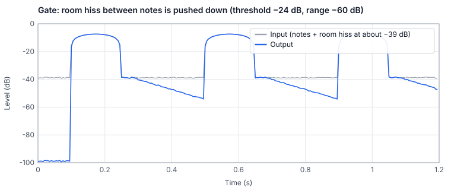

Hiss sits at about −39 dB between notes. When a note ends, the gate holds, then glides the hiss down toward −100 dB.

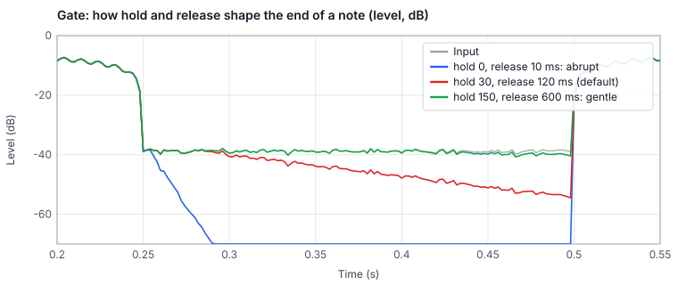

The end of one note. A short release snaps shut, and a long hold and release fade it gently.

The gate responds to instant peaks, not average loudness. A dense noise floor close to the threshold can flicker the gate; raise the threshold or the hold.
</details>

## Compressor

**What it is:** an automatic volume rider. When the sound goes over the threshold, it turns that part down, so loud and quiet parts end up closer together. Vocals sit steadily in the mix, and you can push the track louder overall with Makeup.

| Setting | Range (default) | What it does |
| --- | --- | --- |
| Threshold | −60 to 0 dB (−18) | The level where it starts working. Lower means more of the sound gets compressed. |
| Ratio | 1 to 20 (3) | How hard it pushes down. At 3:1, 3 dB over the threshold comes out as 1 dB over. 2–4 is gentle and natural, 8–20 is limiting (a hard ceiling), and 1 is off. |
| Knee | 0 to 24 dB (6) | How gradually compression starts around the threshold. 0 is an abrupt start; wider is smoother and less noticeable. |
| Attack | 0.1 to 200 ms (10) | How fast it reacts when the sound gets loud. Fast catches peaks but can dull consonants; slower lets the first "punch" through. |
| Release | 5 to 2,000 ms (120) | How fast it lets go after the sound drops. Fast can "pump" (the volume audibly breathes); slow is smoother but can keep the next quiet part turned down. |
| Makeup | 0 to 24 dB (0) | Adds level back after compressing. Set it so bypass on and off sound equally loud. |

<details><summary>Advanced: what happens to the wave</summary>

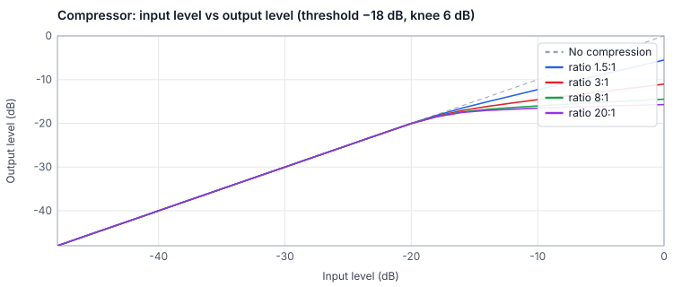

Below −18 dB nothing changes (the diagonal). Above it the line flattens: the higher the ratio, the flatter. The knee rounds the corner.

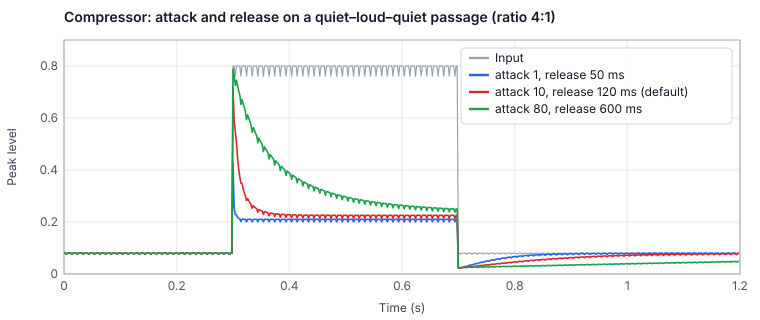

A quiet–loud–quiet passage.
- **Attack:** shows as the spike at the loud entry before the compressor catches up. A slow attack lets more through.
- **Release:** shows as the dip after the loud part, while the compressor lets go.

This compressor reacts to instant peaks; there's no average-loudness (RMS) mode yet (PENDING).
</details>

## Delay

**What it is:** an echo that repeats the sound after a set time. Short times (30–120 ms) thicken or "slapback"; longer times (250–750 ms) give rhythmic echoes. Synced to the tempo, the echoes become part of the groove.

| Setting | Range (default) | What it does |
| --- | --- | --- |
| Time | 1 to 2,000 ms (375) | The gap between echoes. Ignored when Sync is on. |
| Sync | off, 1/4, 1/8, 1/8d, 1/16, 1/4t (off) | Locks the time to the song tempo. **1/8d** (dotted eighth) is the classic bouncing echo; **1/4t** is a triplet feel. |
| Feedback | 0 to 0.95 (0.35) | How much of each echo feeds back into the next. 0 is a single echo, 0.5 a handful, and 0.9 or more a long trail that builds up. |
| Tone | 500 to 16,000 Hz (6,000) | A lowpass on the repeats: lower makes each echo darker than the last, like tape or analog delays. 16k keeps echoes bright. |

<details><summary>Advanced: what happens to the wave</summary>

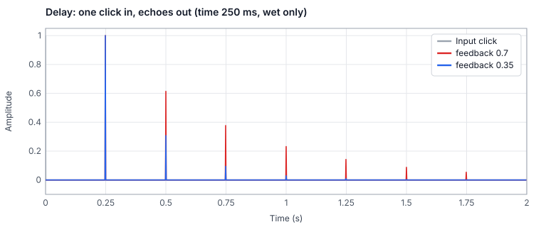

One click in. Each echo is the previous one times the feedback.

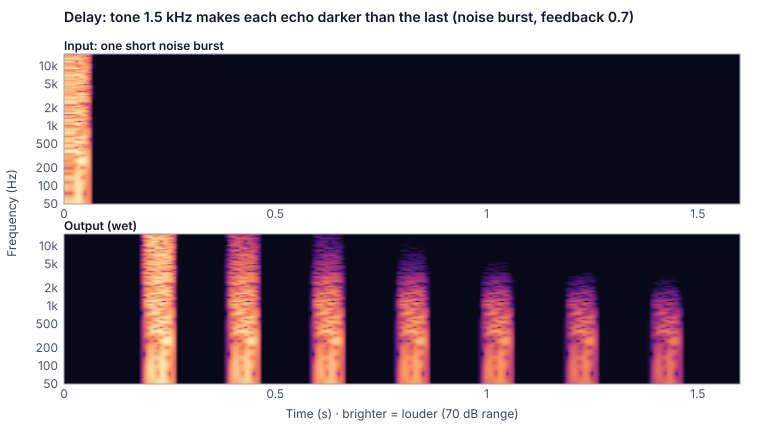

With a 1.5 kHz tone, the high frequencies fade out of each repeat faster than the lows.
</details>

## Reverb

**What it is:** the sound of a room, hall or space. It surrounds the voice with thousands of tiny reflections that fade away. A little makes a dry recording sound natural; a lot makes it dreamy or distant.

| Setting | Range (default) | What it does |
| --- | --- | --- |
| Size | 0 to 1 (0.5) | How big the space is. Small sounds like a closet or booth (dense, quick reflections); large sounds like a hall (spread-out reflections). |
| Decay | 0.1 to 12 s (1.8) | How long the tail rings: roughly the time to fade by 60 dB. 0.3–0.8 s is a room, 1.5–3 s a hall, 6 s or more an ambient wash. |
| Damping | 0 to 1 (0.5) | How fast the highs die compared with the lows. 0 is bright (tile, metal); 1 is dark and warm (curtains, wood). |
| Pre-delay | 0 to 200 ms (20) | A gap before the reverb starts. 20–60 ms keeps the voice clear in front of the room; 0 blends them. |

**Tip:** keep the mix low (0.15–0.35) on lead vocals. To make a voice sound far away, raise both mix and damping.

<details><summary>Advanced: what happens to the wave</summary>

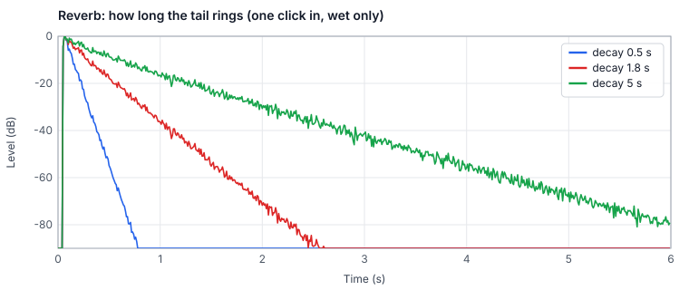

The tail falls in a straight line on a dB scale. Decay sets the slope.

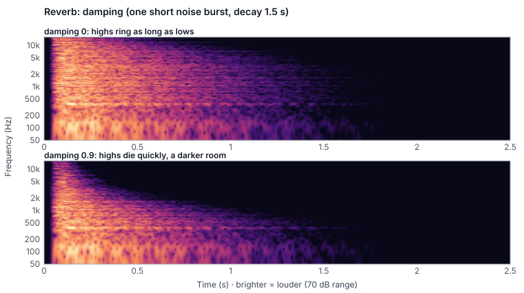

One short noise burst. With damping, the highs (top) fade long before the lows.

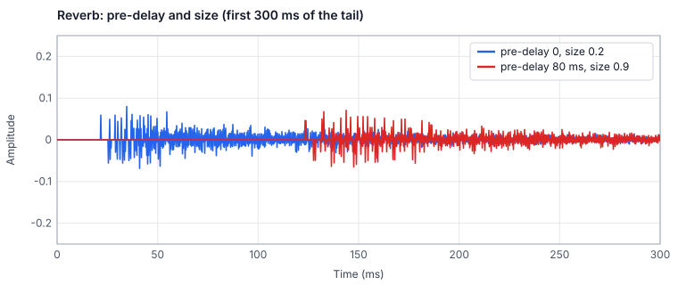

The first 300 ms. Pre-delay pushes the start later, and a bigger size spaces the first reflections further apart.
</details>

## Saturation

**What it is:** controlled distortion. It flattens the peaks of the wave, which adds overtones. A little sounds warm or "analog"; a lot sounds gritty or fuzzy. It also makes quiet details louder relative to peaks.

| Setting | Range (default) | What it does |
| --- | --- | --- |
| Drive | 0 to 36 dB (12) | How hard the sound is pushed into the curve. More drive means more overtones and grit. |
| Mode | soft, hard, tube, fold (soft) | The shape of the distortion (see the curves). **soft** is a smooth, gentle rounding. **hard** clips flat at a ceiling: buzzy and aggressive. **tube** is lopsided, adding even overtones too: warm, "amp-like". **fold** wraps the wave back on itself when it's pushed too far: metallic, synth-like, wild at high drive. |
| Tone | 500 to 16,000 Hz (8,000) | A lowpass after the distortion; lower tames fizz and harshness. |
| Output | −24 to +12 dB (−3) | Level after distortion. Drive makes things louder, so turn this down to compare fairly. |

<details><summary>Advanced: what happens to the wave</summary>

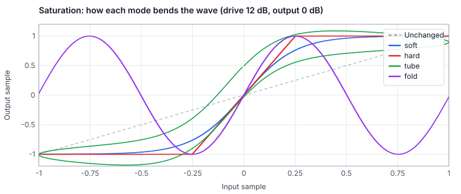

How each mode reshapes sample values (drive 12 dB).
- **soft** bends smoothly.
- **hard** cuts flat.
- **tube** is asymmetric. The small loop is its built-in offset remover (a DC blocker) at work.
- **fold** goes back down after the top.

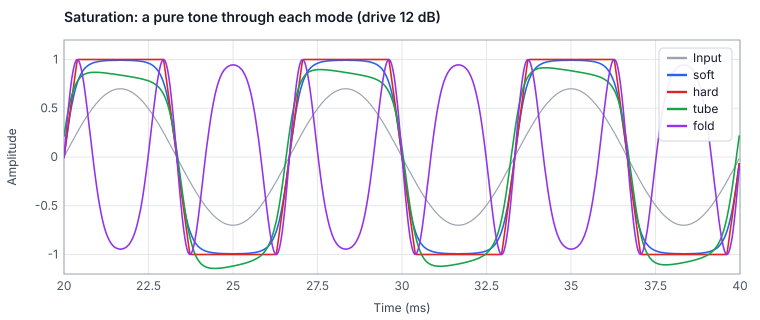

A pure tone. Each mode turns the round sine into a different shape.

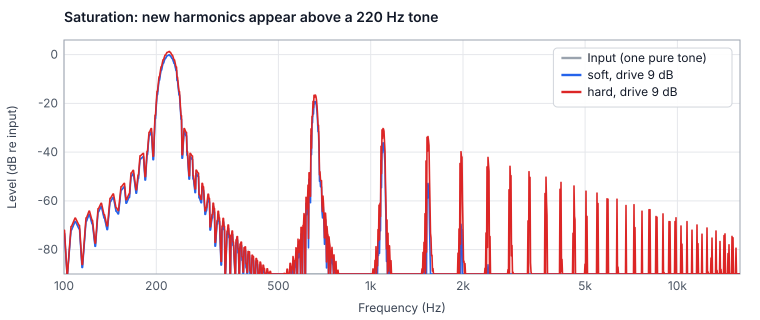

A single 220 Hz tone gains overtones at 660, 1100, 1540 Hz and so on (odd multiples). Hard clipping adds more of them and higher up than soft, which is why it sounds harsher.

There's no oversampling yet, so very high drive can add faint non-musical tones (aliasing) (PENDING).
</details>

## Bitcrusher

**What it is:** digital destruction on purpose. It lowers the resolution of the audio, for retro video-game, lo-fi or robotic textures.

| Setting | Range (default) | What it does |
| --- | --- | --- |
| Bits | 1 to 16 (8) | How many loudness steps the wave can use. 16 is clean, 8 slightly gritty, 4 crunchy, and 1–2 a harsh buzz. |
| Downsample | 1 to 32 (4) | Holds each sample for N samples, which lowers the effective sample rate. Higher adds metallic, out-of-tune tones and removes real highs. |

<details><summary>Advanced: what happens to the wave</summary>

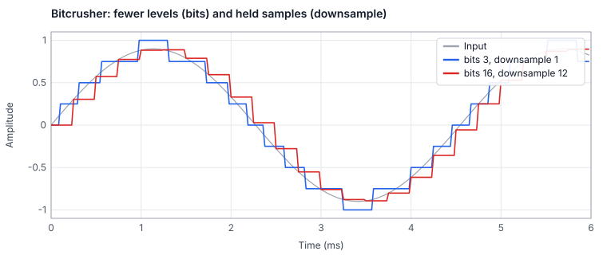

Fewer bits turn the smooth wave into stairs. Downsampling stretches each step sideways.

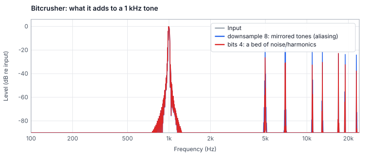

A 1 kHz tone gains new tones that aren't musically related to it. Downsampling creates mirror images (aliasing), and fewer bits adds distortion products.
</details>

## Auto filter

**What it is:** a filter that moves by itself.
- In **LFO** mode it sweeps up and down in a steady cycle (wobble, slow sweep).
- In **Envelope** mode it follows how loud you sing: louder opens it brighter. That's the "auto-wah" or funk effect, and it reacts to your dynamics.

| Setting | Range (default) | What it does |
| --- | --- | --- |
| Type | lowpass, bandpass, highpass (lowpass) | Which filter moves. **bandpass** gives the vocal "wah". |
| Base | 40 to 8,000 Hz (400) | Where the filter sits at rest (bottom of the sweep). |
| Depth | 0 to 6 octaves (3) | How far up it sweeps from the base. Each octave doubles the frequency: 3 octaves from 400 Hz reaches 3.2 kHz. |
| Source | lfo, envelope (lfo) | What moves it: a steady cycle or your loudness. |
| Rate | 0.05 to 20 Hz (1) | LFO speed in sweeps per second. Below 0.5 is a slow evolving sweep, 2–8 a wobble, and 10 or more a buzzy flutter. Ignored when Sync is on. |
| Sync | off, 1/1, 1/2, 1/4, 1/8 (off) | Locks the LFO to the tempo: one sweep per bar, half, quarter or eighth note. |
| Q | 0.5 to 18 (4) | Resonance. Higher sounds more vocal ("wow") and squelchy. |
| Env attack | 1 to 200 ms (10) | Envelope mode: how fast it opens when you get louder. |
| Env release | 10 to 2,000 ms (200) | Envelope mode: how fast it falls back when you get quieter. Long gives a slow "yoww". |

Envelope reaches full depth at a peak level of 0.25 (about −12 dB). Quieter singing opens it proportionally less.

<details><summary>Advanced: what happens to the wave</summary>

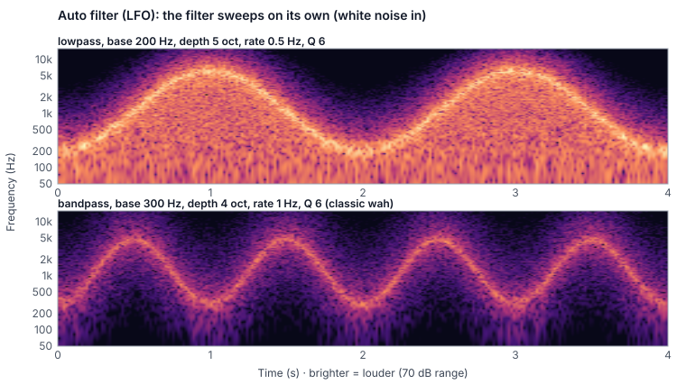

White noise in. The bright band is what gets through the filter, moving in a steady cycle.

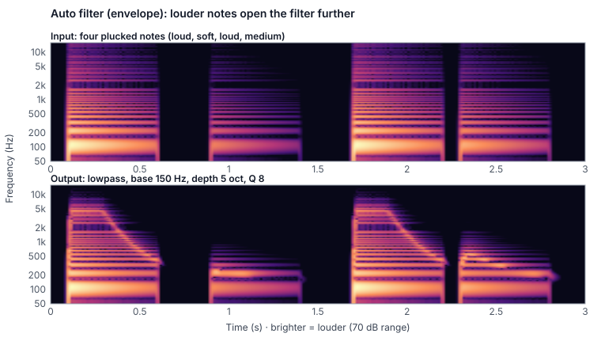

Four plucked notes. Loud notes open the filter high (bright top), the soft note barely opens it, and each closes as the note fades.
</details>

## Chorus

**What it is:** makes one voice sound like several. It adds a copy that's slightly delayed and gently drifting in pitch, like several singers who are never perfectly together. Use it for width, shimmer and a dreamy thickness.

| Setting | Range (default) | What it does |
| --- | --- | --- |
| Rate | 0.05 to 5 Hz (0.8) | How fast the copy drifts. Slow is lush; fast is warbly or seasick. |
| Depth | 0 to 15 ms (4) | How far the copy's timing swings, so how much it goes out of tune. More is more obvious; too much sounds detuned. |
| Delay | 5 to 40 ms (15) | The copy's average delay. Short is tighter and more metallic; long is more like a separate singer (doubling). |
| Feedback | 0 to 0.9 (0) | Feeds the copy back into itself: richer, more resonant, a little metallic. |

Mix 0.5 (the default) is the classic sound; at mix 1 you only hear the drifting copy (a vibrato effect).

<details><summary>Advanced: what happens to the wave</summary>

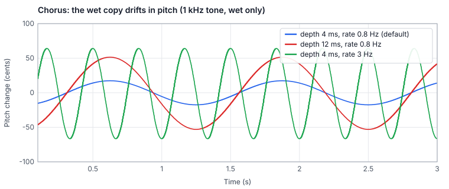

How far the copy's pitch drifts, in cents (100 cents = a semitone). The default stays within about ±17 cents, a gentle detune. More depth or rate means more wobble.

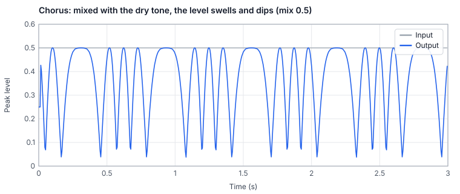

Mixed with the original, the two copies drift in and out of phase, so the level swells and dips. That's the "shimmer".
</details>

## Flanger

**What it is:** the jet-plane "whoosh". Like a chorus, it mixes the sound with a slightly delayed copy, but at a much shorter delay (around 1–10 ms), so the result is a metallic comb of notches sweeping through the sound.

| Setting | Range (default) | What it does |
| --- | --- | --- |
| Rate | 0.05 to 5 Hz (0.3) | Sweep speed. Slow is the classic jet; fast is a rapid warble. |
| Depth | 0 to 8 ms (2) | How far the sweep travels. More is more dramatic. |
| Delay | 0.1 to 10 ms (1) | The center of the sweep. Shorter puts the notches higher and wider apart. |
| Feedback | −0.95 to +0.95 (0.6) | Resonance: sharper, more metallic, more "ringing". Negative values put peaks where positive values put notches, a hollower sound. |

**Mix note:** the comb comes from mixing the copy with the original. With **negative feedback at mix 0.5 the comb nearly cancels out**, so use mix near 1 for negative feedback.

<details><summary>Advanced: what happens to the wave</summary>

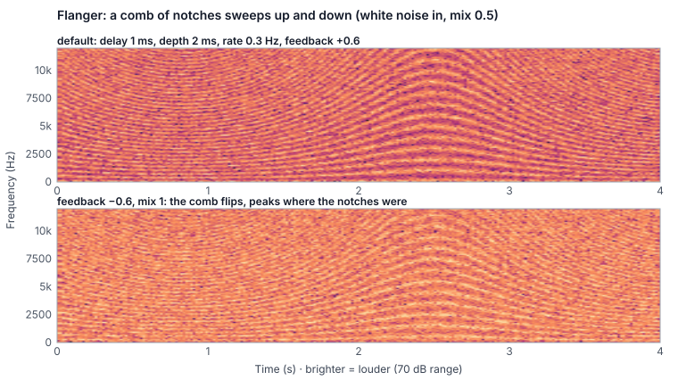

White noise in. The dark stripes are notches, evenly spaced (a comb), sweeping up and down together.
</details>

## Phaser

**What it is:** a softer, smoother swirl than a flanger. Instead of a full comb, it sweeps a few broad notches through the sound. It's a 70s-guitar or electric-piano swirl that works well on sustained vocals and pads.

| Setting | Range (default) | What it does |
| --- | --- | --- |
| Rate | 0.05 to 5 Hz (0.5) | Sweep speed. |
| Stages | 2, 4, 6, 8, 12 (6) | How many notches: half the stages, so 6 stages make 3 notches. More is a stronger, more complex swirl. |
| Depth | 0 to 1 (0.8) | How far the notches sweep (up to ±2 octaves around the center). |
| Feedback | 0 to 0.9 (0.5) | Sharper, more resonant notches with a more vocal or "wet" swirl. |
| Center | 100 to 4,000 Hz (800) | The middle of the sweep. |

<details><summary>Advanced: what happens to the wave</summary>

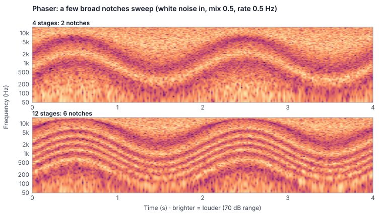

White noise in. Compared with the flanger there are only a few dark bands, unevenly spaced, moving together. More stages, more bands.
</details>

## Tremolo

**What it is:** rhythmic volume pulsing. The level goes up and down in a regular cycle, from a gentle throb to a hard on/off chop. Synced to the tempo, it becomes a rhythmic "stutter" or "gated" effect.

| Setting | Range (default) | What it does |
| --- | --- | --- |
| Rate | 0.1 to 20 Hz (5) | Pulses per second. Ignored when Sync is on. |
| Depth | 0 to 1 (0.6) | How far the level dips. 1 goes fully silent at the bottom of each pulse. |
| Shape | sine, triangle, square (sine) | **sine** is smooth and vintage; **triangle** a bit more pointed; **square** a hard on/off chop (slightly softened so it never clicks). |
| Sync | off, 1/4, 1/8, 1/16 (off) | One pulse per quarter, eighth or sixteenth note. |

<details><summary>Advanced: what happens to the wave</summary>

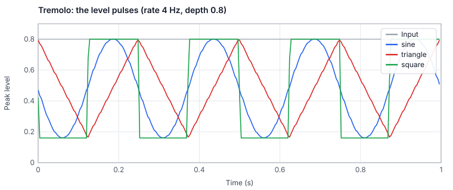

The level over one second at 4 pulses per second, one line per shape.
</details>

## Ring mod

**What it is:** multiplies your voice by a steady tone. It creates new, unrelated pitches (sums and differences), which gives robot voices, bells, sci-fi and "Dalek" sounds. Low carrier frequencies (under 30 Hz) instead give a fast, choppy tremolo.

| Setting | Range (default) | What it does |
| --- | --- | --- |
| Freq | 1 to 4,000 Hz (220) | The carrier tone. 1–20 Hz is a choppy tremolo, 30–200 Hz a robot or growl, and higher is clangy and bell-like. Matching it to the song's key can make it more musical. |

<details><summary>Advanced: what happens to the wave</summary>

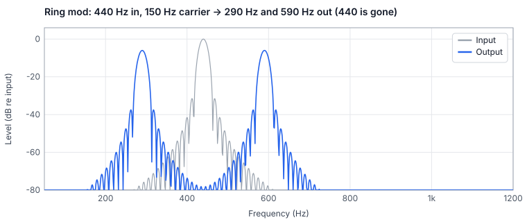

A 440 Hz tone multiplied by 150 Hz gives 290 Hz (440 − 150) and 590 Hz (440 + 150). The original pitch disappears, which is why it sounds inharmonic.

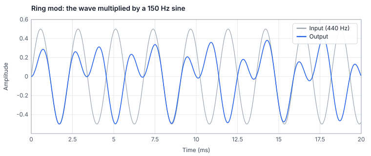

The wave is multiplied by a slower sine, so it flips polarity each half-cycle of the carrier.
</details>

---

## Glossary

| Term | Meaning |
| --- | --- |
| **dB (decibel)** | A log scale for loudness. +6 dB ≈ twice the amplitude, −6 dB ≈ half, −20 dB = one tenth. 0 dB at the output is the loudest before clipping. |
| **Hz (hertz)** | Cycles per second. As a pitch, low bass is 40–100 Hz, a singing voice's fundamental 100–1,000 Hz, and "air" 10 kHz or more. As a rate (LFOs), it's sweeps per second. |
| **Octave** | Doubling the frequency. 400 Hz up 1 octave is 800 Hz; up 3 octaves is 3,200 Hz. |
| **Cents** | Hundredths of a semitone; 100 cents is one semitone. |
| **Cutoff** | Where a filter starts cutting. |
| **Q / resonance** | How sharp a filter's corner or band is. High Q makes a narrow band or a ringing peak. |
| **Harmonics / overtones** | Higher frequencies at whole-number multiples of a note's pitch. They give a sound its color, and distortion adds them. |
| **Aliasing** | Unwanted, non-musical tones created when digital processing makes frequencies higher than the sample rate can represent. |
| **LFO** | Low-frequency oscillator: a slow, steady wave that moves a setting up and down automatically. |
| **Envelope** | The loudness contour of a sound over time. An envelope follower turns your loudness into movement. |
| **Feedback** | Feeding an effect's output back into its input, for more repeats, ringing or resonance. |
| **Wet/dry** | Wet is the processed signal and dry the original. The mix blends them. |
| **Comb filter** | Many evenly spaced notches, made by mixing a sound with a short-delayed copy (flanger). |
| **Clipping** | When a wave hits a ceiling and gets flattened, which is distortion. |
| **Attack / release** | How fast a dynamics effect reacts when the sound gets louder (attack) or quieter (release). |
| **Threshold** | The level where a gate or compressor starts acting. |

## Oscilloscope (planned)

**PENDING:** a live oscilloscope (and later a live spectrum view) next to the effect boxes, so you can see these pictures happening on your own voice. Planned shape:

- **Waveform scope:** a short window (10–50 ms), triggered on rising zero crossings so a held note stands still. A before/after toggle compares the input with the chain output, or a chosen effect's output.
- **Spectrum and spectrogram modes:** these reuse the same math as these figures (Hann window and magnitude spectrum). The existing analysis spectrum may be enough.
- **Realtime safety:** the audio thread fills a preallocated ring of decimated samples, and the UI reads summaries at screen rate. Raw audio never crosses the Tauri bridge (summaries only, per AGENTS.md).
- **Settings:** the window length, trigger, freeze and scale go in the registry as `scope.*`.
